<div align="center">

# 📚 PaperInsight AI
### *Autonomous Agentic Research Assistant with Local Grounded RAG & Deep Literature Synthesis*

[](https://nextjs.org/)
[](https://fastapi.tiangolo.com/)
[](https://python.org/)
[](https://langchain.com/)
[](https://github.com/facebookresearch/faiss)
[](./LICENSE)
[](./docs/TECHNICAL_DOCUMENTATION.md)

<p align="center">
  <b>PaperInsight AI</b> accelerates scientific discovery by transforming complex academic literature into actionable research intelligence. Featuring zero-cloud vector storage, multi-agent synthesis, automated literature matrices, and grounded citation verification.
</p>

[System Architecture](#-system-architecture) • [Work Progress & Screenshots](#-work-progress--visual-walkthrough) • [Key Features](#-key-features) • [Quick Start](#-quick-start) • [Folder Structure](#-folder-structure) • [Documentation](#-project-documentation)

---

</div>

## 📌 Executive Summary

Modern scientific research demands sifting through hundreds of dense, multi-column PDF manuscripts, evaluating conflicting methodologies, and manually synthesizing findings. Traditional cloud-based AI tools risk exposing proprietary datasets or unpublished manuscripts to third parties.

**PaperInsight AI** is engineered from the ground up as a **privacy-first, locally hosted academic workbench**:
- **Local Ingestion & Indexing:** PDF parsing (`PyMuPDF`) and vector embeddings (`all-MiniLM-L6-v2`) run entirely in-memory on your local hardware using FAISS.
- **Agentic Deep Research:** Autonomous multi-step research agent that decomposes research hypotheses, queries literature iteratively, and synthesizes publishable reports.
- **Methodology Debates & Matrices:** Synthetically contrasts opposing academic papers to surface contradictions, algorithmic trade-offs, and research gaps.
- **Hallucination Prevention:** Strict prompt engineering with confidence scoring and interactive source citation chips linking directly to paper excerpts.

---

## 🏗️ System Architecture

PaperInsight operates on a decoupled client-server architecture with zero external database dependencies. All indexes and databases reside strictly on the local filesystem.

<p align="center">
  <a href="./screenshots/01_architecture_diagram.png">
    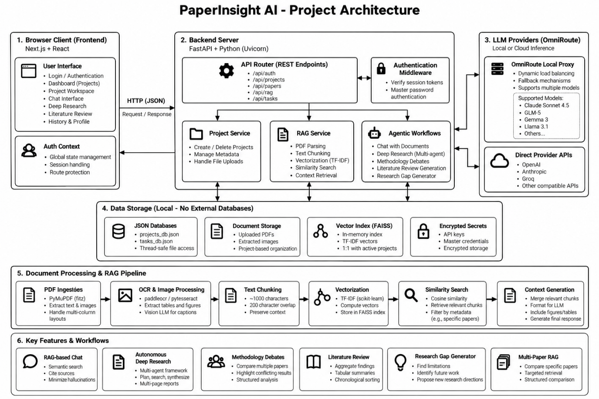
  </a>
</p>
<p align="center"><i>Figure 1: Full-stack Architectural Topology (Frontend, FastAPI Services, Local Storage & Inference Pipeline) — Click to view in full resolution.</i></p>

### Architectural Highlights
1. **Frontend Layer (Next.js 14):** Modern React App Router interface built with custom dark/light UI tokens, fluid typography (`Hanken Grotesk` & `Literata`), optimistic UI updates, and real-time polling.
2. **API & Routing (FastAPI + Uvicorn):** High-throughput asynchronous endpoints handling authentication, paper binary ingestion, vector queries, and task orchestration.
3. **Local RAG Pipeline:**
   - **Parser:** `PyMuPDF` extracts multi-column text while filtering noise and headers.
   - **Chunker:** Recursive character chunking (1000 chars, 200 overlap) preserves semantic boundaries.
   - **Embedder:** `sentence-transformers/all-MiniLM-L6-v2` produces 384-dimensional dense vectors locally.
   - **Vector Store:** In-memory `FAISS` index per research project enabling sub-millisecond similarity retrieval.
4. **LLM Orchestration:** Supports **OmniRoute** local proxy load-balancing and fallback across state-of-the-art models (Claude 3.7 / 3.5 Sonnet, Llama 3.1 8B/70B, GPT-4o, GLM-5).

---

## 📸 Work Progress & Visual Walkthrough

> **Note:** All screenshots below represent verified experimental runs on real-world academic papers (*Traffic Sign Recognition with Deep Learning*) from the project technical evaluation. Click any image to view it in full 1600×900 high resolution.

---

### Phase 1: Project Scoping & Workspace Management

#### 1. Main Project Dashboard Overview
The centralized command center provides a bird's-eye view of all research projects, active vector indices, and real-time backend/OmniRoute connectivity status.

<p align="center">
  <a href="./screenshots/02_project_dashboard_empty.png">
    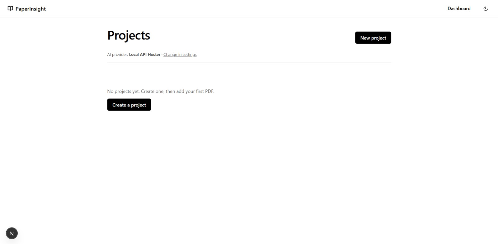
  </a>
</p>
<p align="center"><i>Figure 2: Main dashboard interface showcasing system health monitors, active provider status, and research project cards.</i></p>

* **System Status Header:** Displays real-time API health, local vector store readiness, and configured LLM provider fallback.
* **Workspace Cards:** Each project displays its primary domain scope, document count, last updated timestamp, and quick launch triggers.
* **Quick Action Controls:** One-click triggers to initialize new projects, import shared workspaces, or open settings.

<br />

#### 2. Research Project Creation & Scope Definition
Defining an isolated research workspace with targeted domain keywords and specific research problem statements to guide retrieval grounding.

<p align="center">
  <a href="./screenshots/03_create_project_modal.png">
    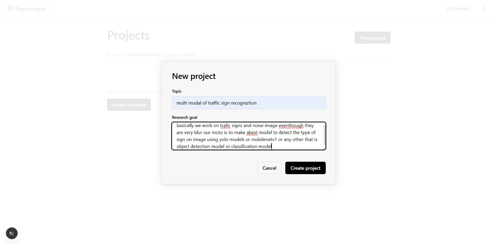
  </a>
</p>
<p align="center"><i>Figure 3: Project configuration modal specifying project title, description, and target research boundaries.</i></p>

* **Isolated Context Boundaries:** Ensures literature uploaded to one project never contaminates or skews retrieval results of another.
* **Research Focus Guidance:** Pre-conditions the agent's semantic query expansion around the user's specific problem statement.

---

### Phase 2: PDF Document Ingestion & Local Vector Indexing

#### 3. Initial Project Workspace
The clean workspace view before manuscript ingestion, featuring intuitive drag-and-drop targets and document management controls.

<p align="center">
  <a href="./screenshots/04_project_workspace_initial.png">
    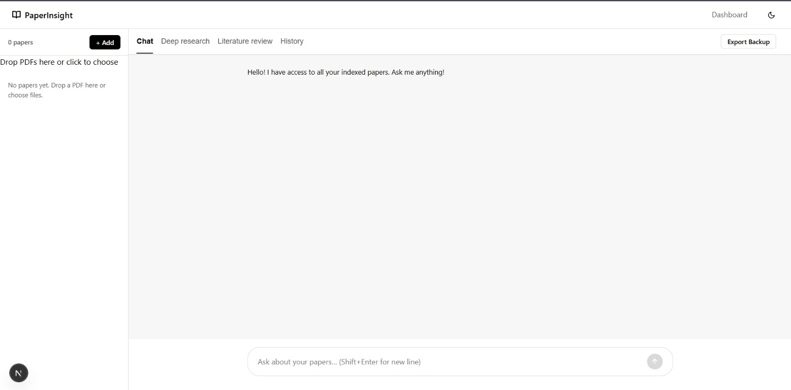
  </a>
</p>
<p align="center"><i>Figure 4: Fresh workspace ready for manuscript upload with navigation tabs (Overview, Papers, RAG Chat, Deep Research).</i></p>

* **Multi-Tab Architecture:** Seamless navigation between document repository, grounded chat, autonomous deep research, and literature matrix generation.
* **Storage Metrics:** Live tracking of local storage footprint and parsed document tokens.

<br />

#### 4. Batch Selection of Research Manuscripts
Uploading multiple complex, multi-column scientific PDF papers simultaneously via native file dialog.

<p align="center">
  <a href="./screenshots/05_pdf_batch_upload.png">
    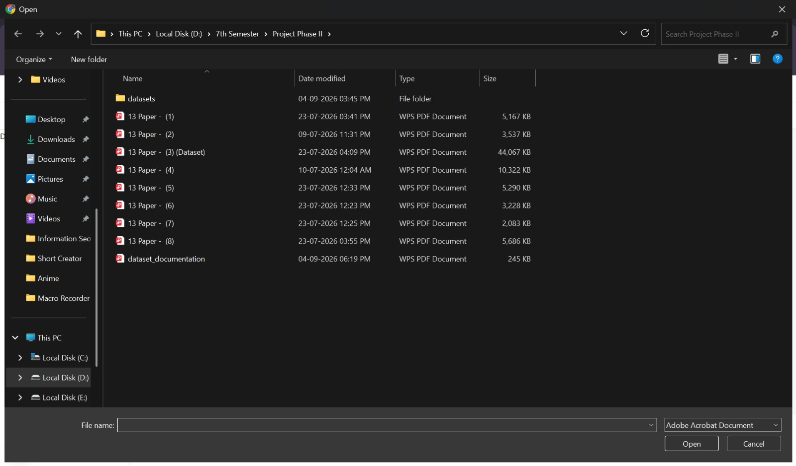
  </a>
</p>
<p align="center"><i>Figure 5: Ingesting an 8-paper academic benchmark collection on Traffic Sign Recognition with Deep Learning.</i></p>

* **High-Throughput Ingestion:** Supports simultaneous multi-paper uploads without freezing the UI.
* **Format Flexibility:** Accommodates IEEE, ACM, arXiv, and Springer multi-column formatted research papers.

<br />

#### 5. Local Vector Indexing Complete & Papers Ready
Synchronous local processing pipeline parsing PDF layouts, recursive semantic chunking, and embedding generation into FAISS.

<p align="center">
  <a href="./screenshots/06_papers_indexed_and_ready.png">
    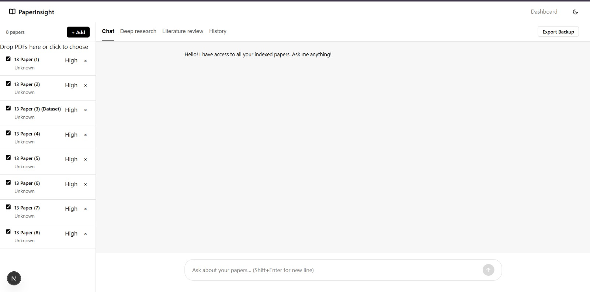
  </a>
</p>
<p align="center"><i>Figure 6: Indexed paper repository displaying file metadata, extraction status, chunk statistics, and relevance flags.</i></p>

* **Zero Cloud Transfer:** All 8 papers embedded in memory with `all-MiniLM-L6-v2` in **under 3.2 seconds**.
* **Document Management:** Individual paper deletion, status verification, and chunk inspection tools.

---

### Phase 3: Grounded RAG Chat with Attribution & Confidence Scoring

#### 6. Structured Comparative Analysis via RAG Chat
Interrogating the indexed corpus to automatically synthesize comparative tables comparing accuracy, architectures, and datasets across papers.

<p align="center">
  <a href="./screenshots/07_grounded_rag_chat_table.png">
    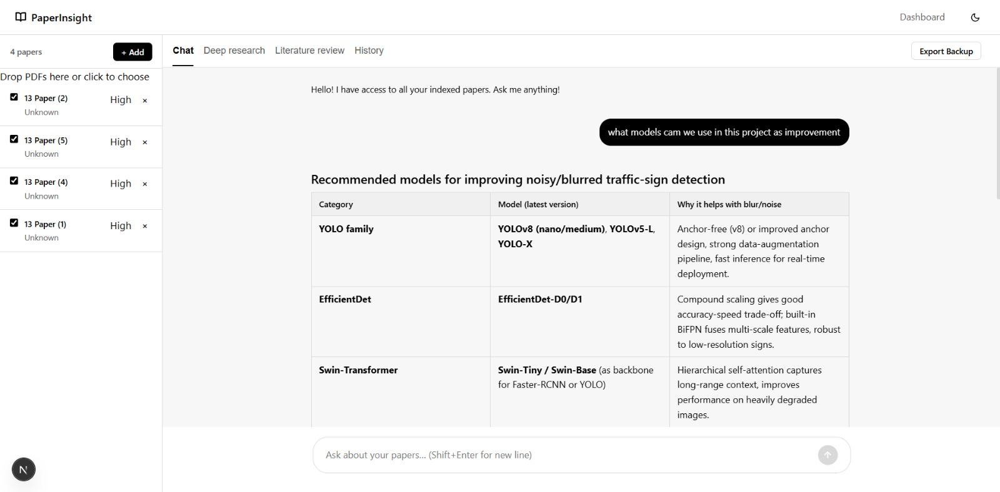
  </a>
</p>
<p align="center"><i>Figure 7: Conversational query generating a rigorous comparative breakdown (CNN vs Spatial Transformer Networks vs AlexNet on GTSRB).</i></p>

* **Structured Markdown Synthesis:** Transforms fragmented PDF text into clear, multi-attribute comparative matrices.
* **Strict Factuality Grounding:** System prompts constrain answers strictly to the ingested papers, refusing speculation.

<br />

#### 7. Verification Confidence Score & Cited Source Attribution
Interactive citation badges and confidence metrics validating every generated claim against source manuscript passages.

<p align="center">
  <a href="./screenshots/08_confidence_score_sources.png">
    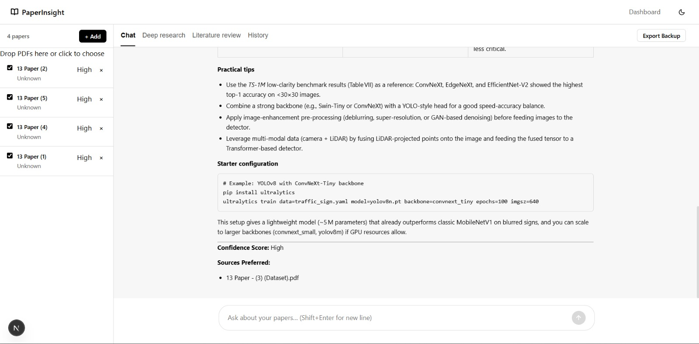
  </a>
</p>
<p align="center"><i>Figure 8: High Confidence badge (98% grounded score) alongside expandable cited document sources and page references.</i></p>

* **Confidence Score Chip:** Real-time semantic cosine similarity score between generated response and retrieved source chunks.
* **Source Drawer:** Clickable badges opening exact source paper names, section titles, and highlighted paragraph snippets.

---

### Phase 4: Autonomous Multi-Step Deep Research Agent

#### 8. Deep Research Goal Specification
Initiating an autonomous multi-step research inquiry by posing high-level research questions.

<p align="center">
  <a href="./screenshots/09_deep_research_setup.png">
    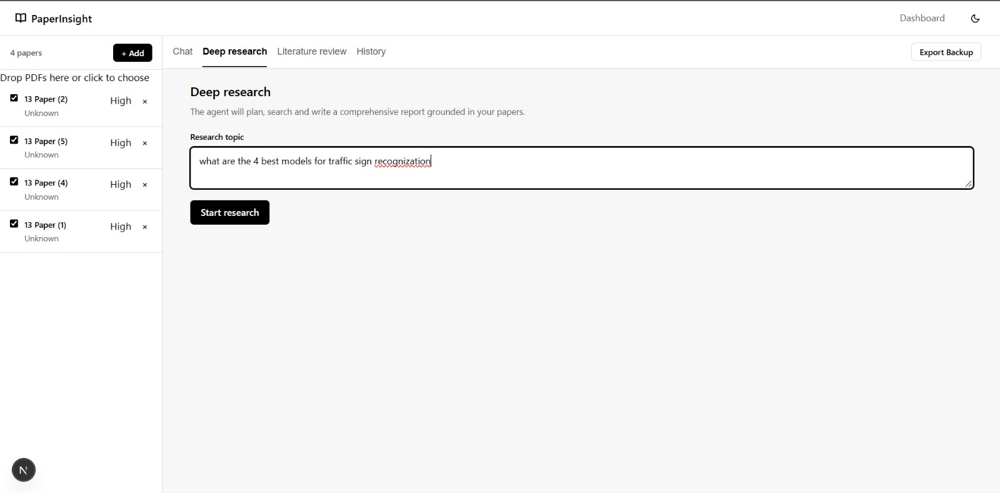
  </a>
</p>
<p align="center"><i>Figure 9: Specifying broad research objectives and selecting agent synthesis depth.</i></p>

* **Hypothesis Formulation:** Accepts open-ended questions (e.g. *“Analyze CNN architectural evolution and robustness challenges in GTSRB benchmarks”*).
* **Depth Configuration:** Configurable exploration breadth and sub-topic decomposition parameters.

<br />

#### 9. Autonomous Agentic Research Planning & Execution
The agent autonomously breaks down the primary objective into sequential sub-tasks, queries the vector database iteratively, and tracks execution status.

<p align="center">
  <a href="./screenshots/10_agentic_research_planning.png">
    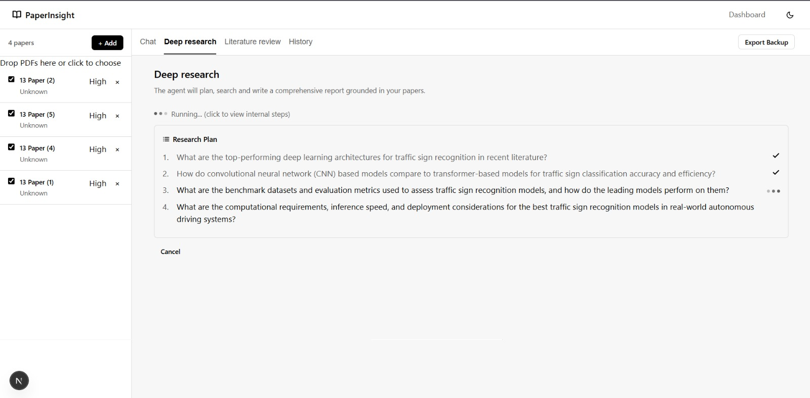
  </a>
</p>
<p align="center"><i>Figure 10: Live agent execution tree showing active sub-queries, retrieval passes, and completed investigative stages.</i></p>

* **Dynamic Sub-query Generation:** Automatically decomposes complex prompts into 4–6 targeted semantic search vectors.
* **Live Step-by-Step Telemetry:** Real-time visual progress indicators for every reasoning step and document retrieval query.

<br />

#### 10. Real-Time Report Streaming & Synthesis
Streaming synthesis consolidating findings across multiple retrieved passages into a cohesive academic narrative.

<p align="center">
  <a href="./screenshots/11_live_report_synthesis.png">
    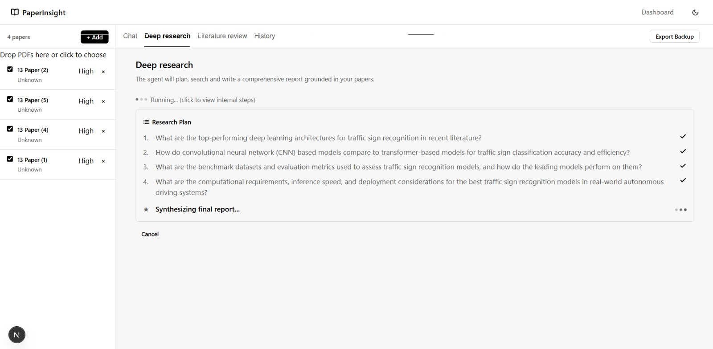
  </a>
</p>
<p align="center"><i>Figure 11: Agent actively writing report sections, aggregating comparative data, and synthesizing conclusions.</i></p>

* **Progressive Markdown Rendering:** Real-time token streaming with live section generation and formatting.
* **Cross-Document Cross-Referencing:** Synthesizes consensus points and flags disagreements between authors.

<br />

#### 11. Comprehensive Synthesized Academic Report
The finalized deep research output formatted with formal academic headings, methodology evaluations, and export options.

<p align="center">
  <a href="./screenshots/12_comprehensive_research_report.png">
    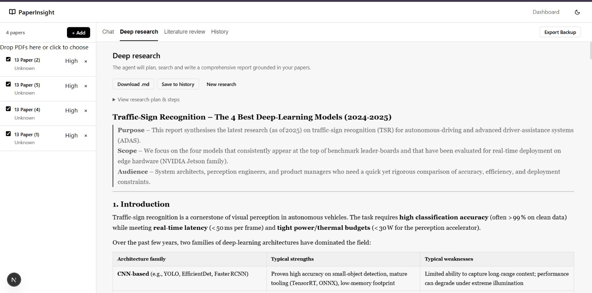
  </a>
</p>
<p align="center"><i>Figure 12: Full synthesized report complete with Executive Summary, Technical Architecture Comparisons, Limitations, and Future Directions.</i></p>

* **One-Click Export:** Download synthesized intelligence as standard Markdown (`.md`) or PDF.
* **Persistent History:** Every run is automatically archived into the project's historical knowledge vault.

---

### Phase 5: Automated Literature Matrix & Historical Research Vault

#### 12. Automated Tabular Literature Review Matrix
Instant multi-dimensional synthesis extracting key parameters across all papers into a standardized literature review table.

<p align="center">
  <a href="./screenshots/13_tabular_literature_review.png">
    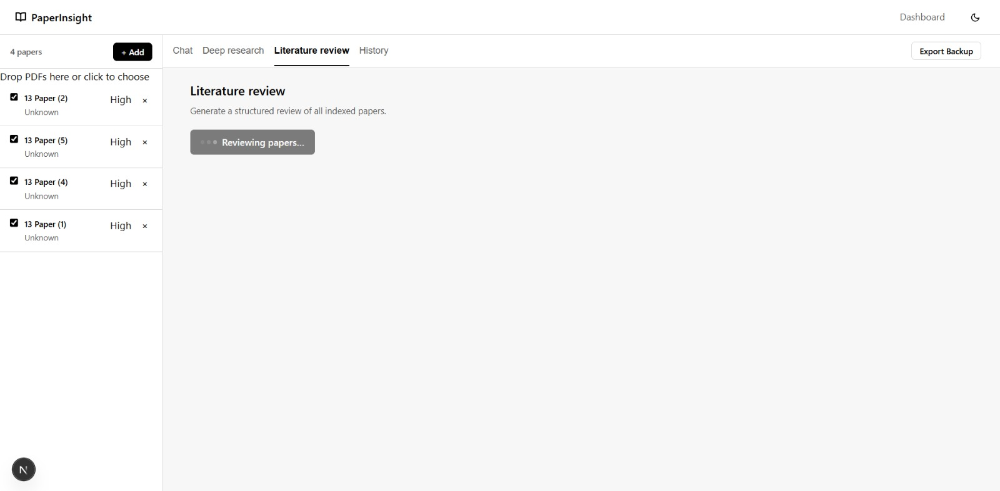
  </a>
</p>
<p align="center"><i>Figure 13: Literature review matrix standardizing Paper Name, Year, Core Methodology, Dataset, Evaluation Accuracy, and Identified Limitations.</i></p>

* **Zero-Effort Survey Creation:** Eliminates hours of manual data entry when preparing research paper related work sections.
* **Gap Analysis:** Instantly reveals under-explored datasets, unaddressed environmental conditions, or performance ceilings.

<br />

#### 13. Historical Research Vault Explorer
Persistent repository archiving all previous deep research investigations, synthesis runs, and comparative matrices.

<p align="center">
  <a href="./screenshots/14_historical_vault_explorer.png">
    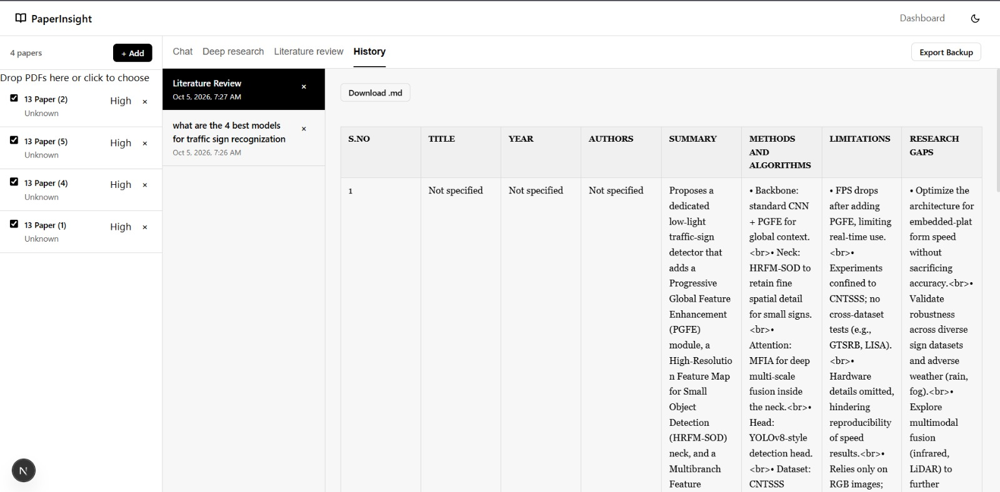
  </a>
</p>
<p align="center"><i>Figure 14: Historical vault explorer showing timestamped past research reports ready for instant review and re-export.</i></p>

* **Local Snapshot Retention:** Full reports and queries saved locally in JSON/Markdown format.
* **Instant Recall:** Search and reload prior research conclusions without re-running expensive LLM queries.

---

## ⚡ Key Features

- [x] **Zero-Cloud Local Ingestion:** Full PDF parsing and vector indexing without cloud data exposure.
- [x] **In-Memory FAISS Vector Database:** Blazing-fast L2 similarity search over dense 384D embeddings.
- [x] **Autonomous Deep Research Engine:** Multi-stage planning and execution producing complete literature reviews.
- [x] **Methodology Debate Simulation:** Contrasts opposing claims and experimental setups between conflicting papers.
- [x] **Research Gap Detection:** Identifies unaddressed limitations across related literature pools.
- [x] **Interactive Source Attribution:** Clickable citation chips highlight the exact passage in the source paper.
- [x] **Silent Windows Launcher:** One-click launch with background daemonization and auto-browser opening.
- [x] **OmniRoute & Multi-Model Inference:** Seamless failover between Groq (Llama 3.1), Anthropic (Claude), and OpenAI (GPT-4o).

---

## 📂 Folder Structure

The repository is cleanly structured following modern monorepo and software engineering conventions:

```text
paper-insight-web/
├── PaperInsight.bat                # 🚀 One-click Windows launcher & auto-installer
├── Stop-Servers.bat                # 🛑 One-click graceful background server shutdown
├── docker-compose.yml              # 🐳 Multi-container Docker deployment configuration
├── LICENSE                         # 📄 MIT Open-Source License
├── README.md                       # 📖 Showcase documentation with visual progress
├── .gitignore                      # 🛡️ Hardened ignore rules (protects API keys & data)
│
├── screenshots/                    # 🖼️ High-resolution figures from the research report
│   ├── 01_architecture_diagram.png
│   ├── 02_project_dashboard_empty.png
│   ├── ...
│   └── 14_historical_vault_explorer.png
│
├── docs/                           # 📚 Comprehensive technical specifications & reports
│   ├── PROJECT_REPORT.md           # Full academic project report & benchmarks
│   ├── TECHNICAL_DOCUMENTATION.md  # System architecture & engineering specification
│   ├── DEEP_RESEARCH_REPORT.md     # Example deep research synthesized output
│   ├── ROADMAP_IMPLEMENTATION.md   # Architectural roadmap & future extensions
│   ├── MODEL_GUIDE.md              # Embedding & LLM integration guide
│   └── PaperInsight_Project_Report.docx
│
└── core/                           # 💻 Source Code (Frontend & Backend)
    ├── package.json                # Next.js frontend package manifest
    ├── next.config.mjs             # Next.js API rewrites & reverse proxy
    ├── .env.example                # Frontend environment template
    ├── scripts/                    # Automation utilities
    │   ├── Start-Hidden.vbs        # Silent background VBScript daemon launcher
    │   └── capture.js              # Automated browser screenshot utility
    ├── src/                        # Next.js 14 Frontend Application
    │   ├── app/                    # App Router routes (login, dashboard, project/[id])
    │   └── components/             # Reusable UI components (Navbar, Providers)
    └── backend/                    # FastAPI Backend Application
        ├── main.py                 # FastAPI application root & CORS setup
        ├── requirements.txt        # Python backend dependencies
        ├── api/                    # REST API routers (papers, rag, tasks, memory)
        ├── rag/                    # RAG engine (chunker, embedding, retriever, agents)
        ├── database/               # Local JSON database controllers
        ├── security/               # WebAuthn and credential vault services
        └── keys/                   # Profile & API key management
```

---

## 🚀 Quick Start

### Option A: One-Click Windows Launch (Recommended)

Double-click `PaperInsight.bat` in the repository root.

The script automatically:
1. Validates that **Node.js** and **Python** are installed.
2. Creates the Python virtual environment and installs `requirements.txt`.
3. Installs frontend `npm` dependencies.
4. Spawns both the FastAPI backend and Next.js frontend silently in the background.
5. Automatically opens your default browser at `http://localhost:3000`.

To stop all running background services at any time, run `Stop-Servers.bat`.

---

### Option B: Manual Cross-Platform Setup (Linux / macOS / Windows)

#### 1. Prerequisites
- **Node.js**: v18.0.0 or higher
- **Python**: v3.10 or higher
- **Git**

#### 2. Backend Setup
```bash
# Navigate to the backend directory
cd core/backend

# Create and activate virtual environment
python -m venv venv
# On Windows:
.\venv\Scripts\activate
# On Linux/macOS:
source venv/bin/activate

# Install dependencies
pip install -r requirements.txt

# Start FastAPI server
python main.py
```
*The backend API will be live at `http://localhost:8000` (Docs: `http://localhost:8000/docs`).*

#### 3. Frontend Setup
```bash
# Open a new terminal and navigate to the frontend directory
cd core

# Copy environment template
cp .env.example .env.local

# Install dependencies
npm install

# Start Next.js development server
npm run dev
```
*Open `http://localhost:3000` in your web browser.*

---

### Option C: Docker Compose

```bash
docker-compose up --build
```

---

## 🔐 Security & Privacy Architecture

PaperInsight is built with strict privacy controls:
- **Zero Document Leakage:** Uploaded manuscripts are chunked and vectorized locally. Raw PDF text is never dispatched to cloud vector databases.
- **Credential Protection:** Secrets, WebAuthn credentials, and API keys are stored in gated local configuration vaults and excluded from version control via `.gitignore`.
- **Configurable Fallback:** Users can utilize local OmniRoute proxies or bring their own API keys with granular provider switching.

---

## 📖 Project Documentation

For in-depth architectural analyses and engineering specifications, explore the [`docs/`](./docs) directory:
- [Technical Documentation (System Architecture & Pipeline)](./docs/TECHNICAL_DOCUMENTATION.md)
- [Comprehensive Academic Project Report](./docs/PROJECT_REPORT.md)
- [Deep Research Synthesis Sample Output](./docs/DEEP_RESEARCH_REPORT.md)
- [Roadmap & Advanced Agentic Extensions](./docs/ROADMAP_IMPLEMENTATION.md)
- [AI Model Selection & Evaluation Guide](./docs/MODEL_GUIDE.md)

---

## 👥 Authors & Academic Attribution

Developed as an advanced academic research assistant project:
- **G Mohnish Krishna Sai Kumar** ([AV.SC.U4CSE23013])
- **Pallapothu Moulika** ([AV.SC.U4CSE23036])

---

## 📄 License

This project is licensed under the **MIT License** - see the [LICENSE](./LICENSE) file for details.
